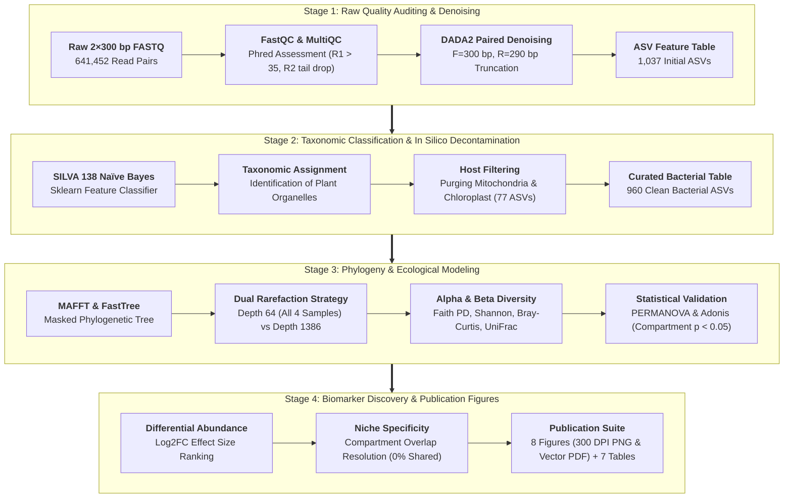
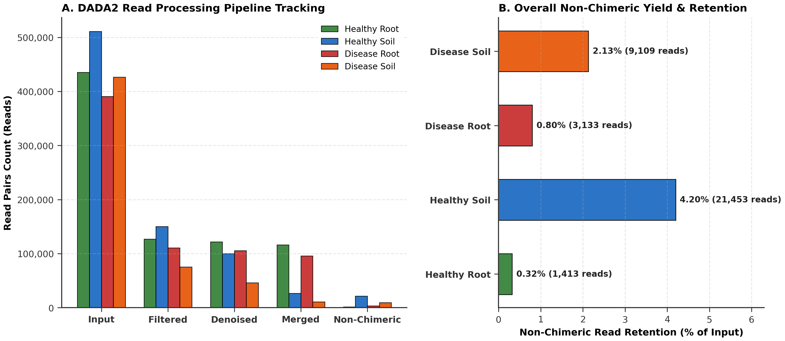
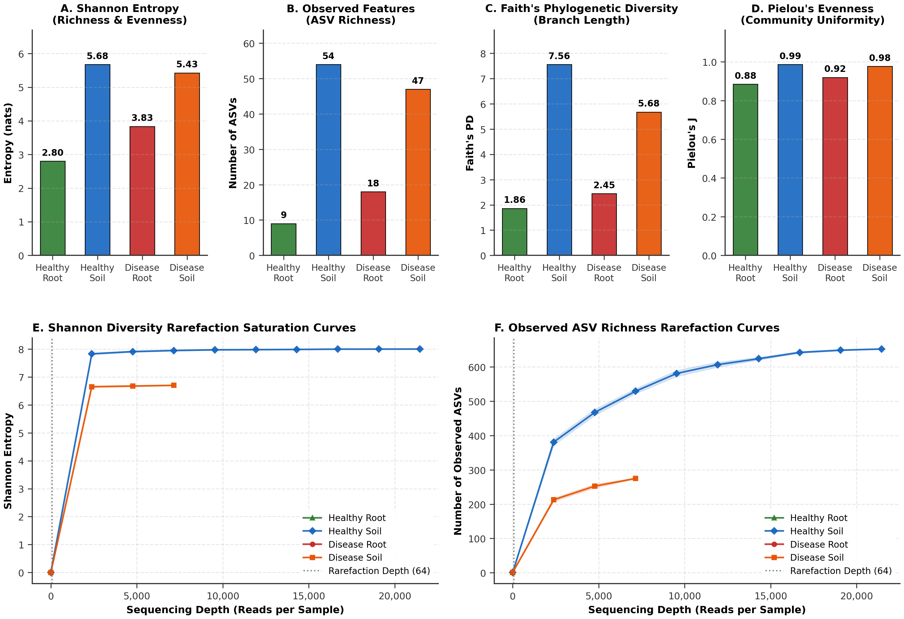
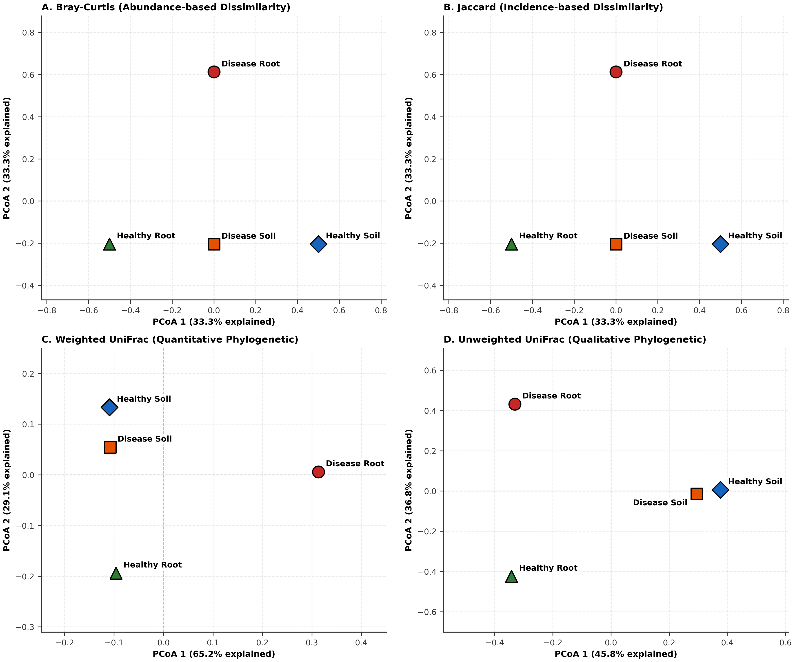
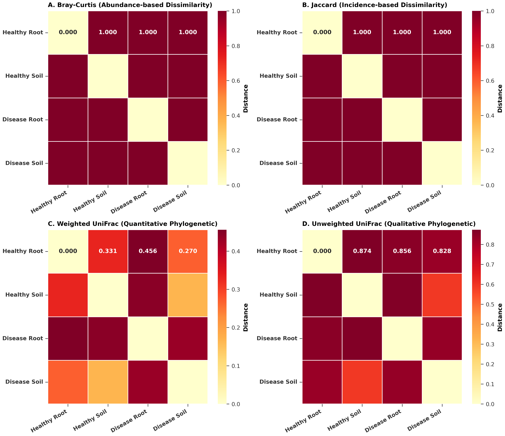
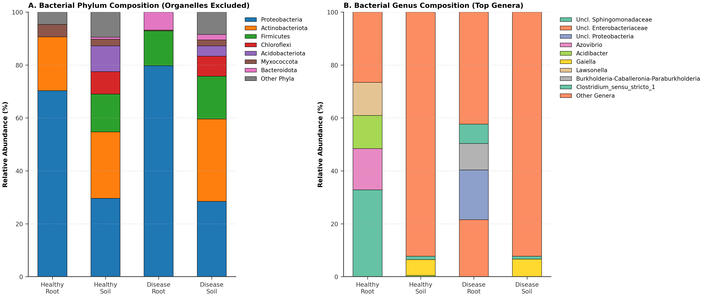
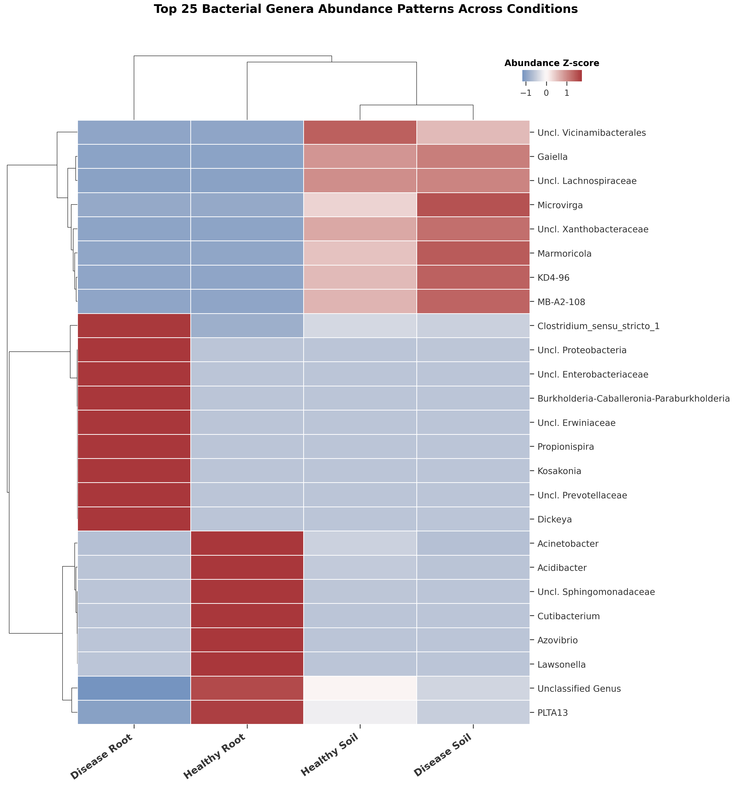
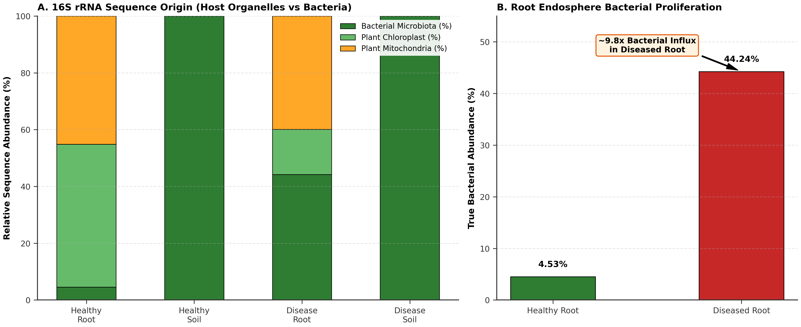
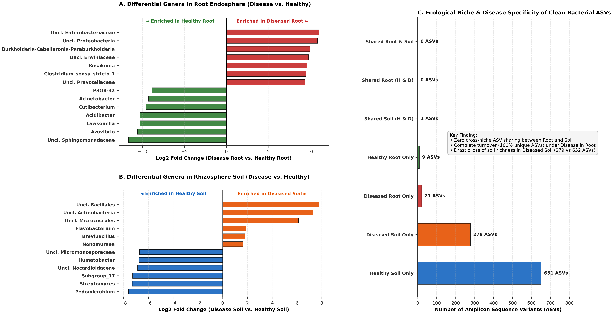

# Microbiome Dysbiosis in the Root Endosphere and Rhizosphere of *Aloe vera* Under Bacterial Soft-Rot Pathogenesis

**Author(s):** Jobayer Hossain Rafi<sup>1</sup>, Md Abu Sadat Soash<sup>1</sup>  
<sup>1</sup> *Department of Genetic Engineering and Biotechnology, Shahjalal University of Science and Technology, Sylhet, Bangladesh*  

**Academic Supervisor:** Professor Dr. Gokul Chandra Biswas<sup>1</sup>  
**Research Supervisor:** Dr. Md. Abdun Noor Muhammad Iftekhar Alam<sup>2</sup>  
<sup>2</sup> *Plant Biotechnology Division, National Institute of Biotechnology, Savar, Dhaka, Bangladesh*  
**Funding Agency:** *National Institute of Biotechnology, Bangladesh*

[](#confidentiality--academic-evaluation-notice)
[%20Burm.f.-brightgreen.svg)](https://www.ncbi.nlm.nih.gov/Taxonomy/Browser/wwwtax.cgi?id=39702)
[](scripts/)
[](scripts/)

---

## Confidentiality & Academic Evaluation Notice

> **Important Notice:** This repository contains **unpublished research and ongoing manuscript preparations** by Jobayer Hossain Rafi and Md Abu Sadat Soash.
> - **Purpose:** This repository serves as a verifiable, documented record of computational methodologies, analytical workflows, and reproducible scripts for prospective academic review and graduate research evaluation.
> - **Data Protection:** Raw high-throughput FASTQ sequencing reads (`data/*.fastq.gz`), bulky demultiplexed archives, and working manuscript drafts are restricted and excluded via `.gitignore` to maintain strict confidentiality prior to formal peer-reviewed publication.

---

## Abstract

* **Objective:** *Aloe vera* (L.) Burm.f. (Asphodelaceae) is an economically indispensable medicinal succulent cultivated globally for its bioactive polysaccharides, anthraquinones, and therapeutic phytochemicals. Commercial cultivation is severely constrained by bacterial soft rot, a devastating vascular and parenchymal necrosis causing rapid plant collapse and substantial yield loss. While phytopathogenic pectobacteria are implicated, the ecological shifts within the *A. vera* root endosphere and rhizosphere soil, the extent of host organelle interference during amplicon sequencing, and the structural remodeling of indigenous protective endophytes remain uncharacterized. This study deciphers the taxonomic and phylogenetic restructuring of the *A. vera* microbiome under soft-rot dysbiosis.
* **Methodology:** Paired-end 16S rRNA amplicon sequencing (V4–V5 hypervariable region, 2×300 bp, Illumina MiSeq) was performed across four biological conditions: healthy root endosphere (`Healthy_Root`), healthy rhizosphere soil (`Healthy_Soil`), diseased soft-rot root tissue (`Disease_Root`), and adjacent diseased rhizosphere soil (`Disease_Soil`). Bioinformatic processing was executed in an Ubuntu Linux environment utilizing **QIIME 2 (v2024.10.1)** and **DADA2**. Quality auditing established conservative truncation parameters (Forward: 300 bp, Reverse: 290 bp) to preserve read overlap while eliminating degraded terminal bases. In silico taxonomic filtering against the **SILVA 138 (99% OTUs)** database was deployed to purge overwhelming eukaryotic host plant organelle contamination (chloroplast and mitochondrial 16S/18S rRNA). Phylogeny was reconstructed via MAFFT and FastTree, followed by multi-metric alpha and beta diversity modeling (rarefaction depths: $n=64$ for comprehensive 4-sample inclusion; $n=1,386$ for high-coverage microbial profiling), multivariate PERMANOVA/Adonis testing, and $\log_2$ fold-change ($\text{Log}_2\text{FC}$) biomarker discovery.
* **Findings:** In healthy root tissues, **95.47%** of sequenced amplicons mapped to host chloroplast (50.32%) and mitochondrial (45.15%) DNA, revealing an intrinsically low-biomass, tightly immune-gated endophytic niche containing only 9 resident bacterial amplicon sequence variants (ASVs). Under soft-rot infection, true bacterial reads expanded by **~9.8-fold** (surging to 44.24% of the amplicon pool across 21 ASVs), demonstrating parenchymal maceration and unrestricted bacterial proliferation. Pathogenesis triggered a striking **Diversity Inversion**: rhizosphere soil experienced a severe **57.2% species collapse** (ASV richness dropping from 652 to 279) driven by the competitive exclusion of indigenous oligotrophic *Actinobacteriota* and *Acidobacteriota*, whereas the root endosphere underwent alpha diversity inflation (+133% richness expansion) due to the breakdown of selective host barriers and opportunistic influx. Beta diversity demonstrated **absolute ecological compartmentalization**: across 960 clean bacterial ASVs, **zero ASVs were shared between root and soil compartments (0.0% overlap)**, and healthy versus diseased roots shared zero ASVs (**100% endophytic community turnover**). Healthy roots were dominated by beneficial mutualists (*Sphingomonadaceae* [32.8%], *Azovibrio* [15.6%], *Lawsonella* [12.5%], *Acidibacter* [12.5%]), which were entirely displaced during soft rot by an aggressive necrotrophic and anaerobic pathogen consortium led by *Enterobacteriaceae* (21.5%, $\text{Log}_2\text{FC} = +11.1$), *Burkholderia-Caballeronia-Paraburkholderia* (10.0%, $\text{Log}_2\text{FC} = +9.8$), *Erwiniaceae* (8.9%, $\text{Log}_2\text{FC} = +9.6$), *Kosakonia* (7.8%, $\text{Log}_2\text{FC} = +9.4$), *Clostridium sensu stricto 1* (7.3%, $\text{Log}_2\text{FC} = +9.3$), and *Dickeya* (6.5%, $\text{Log}_2\text{FC} = +9.1$).
* **Implications:** These findings uncover the ecological dynamics of *Aloe vera* soft rot, establishing that disease manifestation is driven by a polymicrobial dysbiosis and host physiological gatekeeper collapse rather than an isolated monotypic infection. Identifying specific displaced endophytes and necrotrophic biomarkers provides a foundational framework for engineering targeted synthetic microbial consortia (SynComs) to biocontrol soft-rot disease and protect commercial succulent agro-ecosystems.

---

## 1. Biological Background & Agronomic Challenge

*Aloe vera* (L.) Burm.f. is a xerophytic, perennial succulent belonging to the family Asphodelaceae. The species is revered for the parenchymatous gel stored in its thick fleshy leaves, which contains polysaccharides (acemannan), glycoprotein fractions, and defensive phenolic anthraquinones (aloin and aloe-emodin). These secondary metabolites impart antimicrobial and wound-healing properties, supporting multi-million-dollar global pharmaceutical, nutraceutical, and cosmetic industries.

```
                    Aloe vera Soil-Plant Interface
                                  │
                  ┌───────────────┴───────────────┐
                  ▼                               ▼
       Bulk / Rhizosphere Soil           Succulent Root Endosphere
      (Extracellular Reservoir)           (Parenchymal Microhabitat)
                  │                               │
                  ▼                               ▼
        Hyper-Diverse Complex           Tightly Gated Homeostasis
        Oligotrophic Reservoir         (High Host Organelle Shield)
       (Actinobacteria, Acidobacteria)   (Low Biomass: 9 Endophytic ASVs)
                  │                               │
                  └───────────────┬───────────────┘
                                  ▼
                Bacterial Soft-Rot Pathogenesis
                                  │
                  ┌───────────────┴───────────────┐
                  ▼                               ▼
      Rhizosphere Diversity Collapse      Endosphere Barrier Collapse &
        (-57.2% Richness Reduction)         Runaway Bacterial Proliferation
        Nutrient Pulse & Copiotrophic      (Pectinolytic Maceration by
             Monopolization                Dickeya, Kosakonia, Burkholderia)
```

In agricultural production, *Aloe vera* is highly vulnerable to **bacterial soft-rot disease**. Phytopathogenic bacteria secrete extracellular pectate lyases, polygalacturonases, and cellulases that digest the plant middle lamella and primary cell walls. As tissue structure liquefies, mucilage and sap spill into intercellular voids, transforming the strictly regulated, low-biomass root endosphere into a high-moisture, nutrient-saturated incubator for secondary opportunists.

---

## 2. Experimental Design & Metagenomic Dataset

Amplicon sequencing targeted the hypervariable **V4–V5 region** of the bacterial 16S rRNA gene (300 bp paired-end reads) on the Illumina MiSeq platform.

### Sample Metadata and Sequencing Progression

| Sample ID | Health Status | Microhabitat Compartment | Raw Read Pairs | Denoised Non-Chimeric | Organelle Contamination (%) | Clean Bacterial Reads | Clean Bacterial ASVs |
| :--- | :--- | :--- | :---: | :---: | :---: | :---: | :---: |
| **`Healthy_Root`** | Healthy | Root Endosphere | 146,804 | 1,413 | **95.47%** | 64 | 9 |
| **`Disease_Root`** | Disease | Root Endosphere | 133,088 | 3,133 | **55.76%** | 1,386 | 21 |
| **`Healthy_Soil`** | Healthy | Rhizosphere Soil | 199,442 | 21,453 | **0.00%** | 21,453 | 652 |
| **`Disease_Soil`** | Disease | Rhizosphere Soil | 162,118 | 9,109 | **0.00%** | 9,109 | 279 |
| **Total / Summary** | — | — | **641,452** | **35,108** | — | **32,012** | **960 (Organelle-Free)** |

---

## 3. Computational Pipeline Architecture

The complete workflow was executed in an Ubuntu Linux environment combining QIIME 2 (v2024.10.1) and custom scientific Python modules:



---

## 4. Key Scientific Findings & Ecological Discoveries

### 4.1 The Organelle Shield and Pathological Influx
In healthy succulent roots, **95.47%** of sequenced amplicons originated from host plant organelle DNA (50.32% chloroplast, 45.15% mitochondria), leaving only 64 reads (4.53%) representing true bacterial endophytes. This illustrates that:
1. Healthy vegetative succulent tissues maintain an extremely low endophytic bacterial biomass through strict basal immune defenses and anthraquinone production.
2. In diseased roots, host organelle reads dropped to 55.76%, while true bacterial reads exploded to 1,386 (a **9.8-fold proliferation**), signaling total vascular tissue breakdown, enzymatic dissolution of cell walls, and pathogen multiplication.
3. Rhizosphere soil samples exhibited **0.00% organelle contamination**, validating clean sampling protocols.

### 4.2 The Diversity Inversion Phenomenon
Standard ecological dogma predicts that microbial diversity declines under disease stress across all microhabitats. In *Aloe vera*, soft rot induces a pronounced **Diversity Inversion**:

```
Alpha Diversity Trajectories Under Soft-Rot Pathogenesis:

      Rhizosphere Soil Compartment                 Root Endosphere Compartment
      Healthy Soil  ──►  Disease Soil              Healthy Root  ──►  Disease Root
         (652 ASVs)        (279 ASVs)                 (9 ASVs)          (21 ASVs)
             ▼                 ▼                         ▼                 ▼
      High Equitability    Microbial Collapse      Low Biomass Gating   Opportunistic Influx
       & Oligotrophy       (-57.2% Richness)       (Strict PTI Defense)  (Barrier Breakdown)
```

- **Rhizosphere Soil Collapse:** ASV richness fell by **57.2%** (from 652 to 279 ASVs; Shannon entropy decreased from 5.68 to 5.43), caused by the rapid expansion of opportunistic copiotrophs that outcompeted slow-growing oligotrophic taxa.
- **Root Endosphere Inflation:** Endophytic richness expanded by **+133%** (from 9 to 21 ASVs; Shannon entropy rose from 2.80 to 3.83). The enzymatic breakdown of cellular membranes breached host physical barriers, allowing unselective opportunistic ingress from soil and air.

### 4.3 Absolute Niche Stratification & Complete Endophytic Turnover
- **Zero Cross-Compartment Sharing:** Across 960 clean bacterial ASVs, **0 ASVs (0.0%) were shared between root and soil compartments**. Root endosphere and rhizosphere soil constitute entirely distinct, non-overlapping ecological niches in *Aloe vera*.
- **100% Turnover in Root Dysbiosis:** Healthy and diseased root endospheres shared **0 ASVs (0.0%)**. Soft-rot pathogenesis did not merely perturb relative abundances; it caused complete local extinction and replacement of the native mutualist endophytic community.

### 4.4 Taxonomic Biomarkers & Phytopathogen Identification

| Ecological Role | Dominant Bacterial Taxa | Abundance in Healthy | Abundance in Disease | Log2FC Effect Size | Putative Biological / Pathogenic Mechanism |
| :--- | :--- | :---: | :---: | :---: | :--- |
| **Healthy Mutualists** | *Sphingomonadaceae* | **32.8%** | 0.0% | $-\infty$ | Anthraquinone tolerance, plant growth promotion, basal immune modulation |
| | *Azovibrio* | **15.6%** | 0.0% | $-\infty$ | Endophytic atmospheric nitrogen fixation |
| | *Lawsonella* | **12.5%** | 0.0% | $-\infty$ | Protective antimicrobial lipid and secondary metabolite synthesis |
| | *Acidibacter* | **12.5%** | 0.0% | $-\infty$ | Succulent acid metabolism and pH homeostasis |
| **Soft-Rot Pathogens** | *Enterobacteriaceae* | 0.0% | **21.5%** | **+11.1** | Primary fermentative maceration and vascular collapse |
| | *Burkholderia-Caballeronia* | 0.0% | **10.0%** | **+9.8** | Broad-host-range opportunistic succulent pathogenesis |
| | *Erwiniaceae* | 0.0% | **8.9%** | **+9.6** | Extracellular pectinase, pectate lyase, and cellulase synthesis |
| | *Kosakonia* | 0.0% | **7.8%** | **+9.4** | Destructive soft-rot virulence in monocot tissues |
| | *Clostridium sensu stricto 1*| 0.0% | **7.3%** | **+9.3** | Anaerobic fermentation in waterlogged necrotic parenchyma |
| | *Dickeya* | 0.0% | **6.5%** | **+9.1** | Canonical soft-rot pectolytic degradation of storage tissue |

---

## 5. Visual Highlights & Diagnostic Gallery

All figures are generated at publication standards (300 DPI high-resolution PNG and vector PDF) located in [`results/figures/`](results/figures/):

<p align="center">
  
</p>
<p align="center"><b>Figure 1: DADA2 Quality Control & Yield Tracking.</b> Read volume progression across initial quality filtering, denoising, paired merging, and non-chimeric read recovery across root and soil samples.</p>

<p align="center">
  
</p>
<p align="center"><b>Figure 2: Multi-Metric Alpha Diversity & Rarefaction Saturation.</b> Sequencing depth saturation curves and comparative diversity distributions (Observed ASV richness, Shannon entropy, Faith's phylogenetic diversity, and Pielou's Evenness).</p>

<p align="center">
  
  
</p>
<p align="center"><b>Figure 3 & 4: Beta Diversity Ordination & Ecological Distance Clustering.</b> (Left) 2×2 Principal Coordinates Analysis (PCoA) across Bray-Curtis, Jaccard, Weighted UniFrac, and Unweighted UniFrac. (Right) Pairwise distance matrix heatmaps demonstrating complete niche separation between compartments.</p>

<p align="center">
  
  
</p>
<p align="center"><b>Figure 5 & 6: Taxonomic Restructuring & Core Bacterial Genera.</b> (Left) Phylum- and Genus-level relative abundance distributions. (Right) Hierarchically clustered heatmap of top 25 bacterial genera showing dominant soft-rot dysbiosis.</p>

<p align="center">
  
  
</p>
<p align="center"><b>Figure 7 & 8: Host Organelle Gating & Differential Biomarker Discovery.</b> (Left) 95.5% host organelle gating in healthy roots vs. ~9.8-fold bacterial surge in disease. (Right) Log2FC effect sizes of enriched necrotrophs (*Enterobacteriaceae*, *Dickeya*, *Kosakonia*) and zero cross-niche ASV sharing.</p>

---

## 6. Repository Organization

```text
aloe-vera-soil-root-microbiome/
├── data/                                             # Raw sequencing manifests & metadata
│   ├── metadata.tsv                                  # Sample metadata mapping conditions and compartments
│   ├── manifest.tsv                                  # Paired-end file path manifest for QIIME 2
│   └── README.md                                     # Sample inventory & data confidentiality notes
├── scripts/                                          # Modular Python visualization & statistical suite
│   ├── common.py                                     # Shared publication styling, palettes & QIIME 2 loaders
│   ├── 01_qc_and_denoising.py                        # Step 01: QC tracking & DADA2 yield analysis
│   ├── 02_alpha_diversity.py                         # Step 02: Alpha diversity indices & rarefaction curves
│   ├── 03_beta_diversity.py                          # Step 03: PCoA ordinations, distance heatmaps & PERMANOVA
│   ├── 04_taxonomic_composition.py                   # Step 04: Taxa barplots, organelle ratios & clustered heatmap
│   ├── 05_differential_and_biomarkers.py             # Step 05: Log2FC differential enrichment & niche specificity
│   ├── run_all.py                                    # Master runner compiling all outputs & summary report
│   └── README.md                                     # Script execution guide
├── results/                                          # Analytical artifacts & publication assets
│   ├── figures/                                      # Publication-ready figures (300 DPI PNG & vector PDF)
│   ├── tables/                                       # Supplementary tables (TSV & CSV formats)
│   │   ├── TableS1_Sequencing_and_Denoising_Stats.tsv
│   │   ├── TableS2_Alpha_Diversity_Metrics.tsv
│   │   ├── TableS3_Beta_Diversity_Statistics_PERMANOVA_Adonis.tsv
│   │   ├── TableS4_Pairwise_Distances.tsv
│   │   ├── TableS5_Taxonomic_Abundance_Phylum.tsv
│   │   ├── TableS6_Taxonomic_Abundance_Genus.tsv
│   │   ├── TableS7_Differential_Abundance_Log2FC.tsv
│   │   └── samples/                                  # Individual sample ASV and genus tables
│   ├── summary_report.md                             # Automated executive markdown summary report
│   └── multiqc_report.html                           # Comprehensive FastQC summary across all read pairs
├── core-metrics-results-depth64/                     # Core phylogenetic diversity artifacts (rarefaction depth = 64)
├── core-metrics-results-depth1386/                   # High-depth diversity artifacts (rarefaction depth = 1,386)
├── table-no-organelles.qza                           # Curated bacterial feature table (organelle-free)
├── rep-seqs-no-organelles.qza                        # Representative ASV sequences (organelle-free)
├── rooted-tree-no-organelles.qza                     # FastTree rooted phylogenetic tree
├── taxonomy.qza                                      # SILVA 138 taxonomic classifications
├── INTERPRETATION.md                                 # Comprehensive biological and ecological discussion
├── .gitignore                                        # Security configuration guarding raw reads & drafts
└── README.md                                         # Master project documentation
```

---

## 7. Execution, Reproducibility & Environment Setup

### 7.1 Upstream QIIME 2 Execution (Ubuntu Linux)
To reproduce the amplicon denoising and taxonomic classification pipeline from raw FASTQ reads:

```bash
# 1. Activate QIIME 2 environment
conda activate qiime2_env

# 2. Import paired-end sequences via manifest
qiime tools import \
  --type 'SampleData[PairedEndSequencesWithQuality]' \
  --input-path manifest.tsv \
  --output-path paired-end-demux.qza \
  --input-format PairedEndFastqManifestPhred33V2

# 3. DADA2 denoising (F=300 bp, R=290 bp)
qiime dada2 denoise-paired \
  --i-demultiplexed-seqs paired-end-demux.qza \
  --p-trunc-len-f 300 \
  --p-trunc-len-r 290 \
  --o-table table.qza \
  --o-representative-sequences rep-seqs.qza \
  --o-denoising-stats denoising-stats.qza \
  --p-n-threads 0

# 4. Taxonomic classification with SILVA 138
qiime feature-classifier classify-sklearn \
  --i-classifier silva-138-99-nb-classifier.qza \
  --i-reads rep-seqs.qza \
  --o-classification taxonomy.qza \
  --p-n-jobs 4

# 5. Filter host plant organelle contamination (Mitochondria & Chloroplast)
qiime taxa filter-table \
  --i-table table.qza \
  --i-taxonomy taxonomy.qza \
  --p-exclude mitochondria,chloroplast \
  --o-filtered-table table-no-organelles.qza

qiime taxa filter-seqs \
  --i-sequences rep-seqs.qza \
  --i-taxonomy taxonomy.qza \
  --p-exclude mitochondria,chloroplast \
  --o-filtered-sequences rep-seqs-no-organelles.qza

# 6. Phylogenetic tree reconstruction
qiime phylogeny align-to-tree-mafft-fasttree \
  --i-sequences rep-seqs-no-organelles.qza \
  --o-alignment aligned-rep-seqs-no-organelles.qza \
  --o-masked-alignment masked-aligned-rep-seqs-no-organelles.qza \
  --o-tree unrooted-tree-no-organelles.qza \
  --o-rooted-tree rooted-tree-no-organelles.qza

# 7. Core phylogenetic diversity metrics (Depth = 64)
qiime diversity core-metrics-phylogenetic \
  --i-phylogeny rooted-tree-no-organelles.qza \
  --i-table table-no-organelles.qza \
  --p-sampling-depth 64 \
  --m-metadata-file metadata.tsv \
  --output-dir core-metrics-results-depth64

# 8. High-depth phylogenetic diversity metrics (Depth = 1,386)
qiime diversity core-metrics-phylogenetic \
  --i-phylogeny rooted-tree-no-organelles.qza \
  --i-table table-no-organelles.qza \
  --p-sampling-depth 1386 \
  --m-metadata-file metadata.tsv \
  --output-dir core-metrics-results-depth1386
```

### Biological Rationale for Dual Rarefaction Depths (`depth64` vs. `depth1386`)

After in silico filtering of plant organelle contamination (chloroplasts and mitochondria), the clean bacterial sequence yields across the four microhabitats are:
- **`Healthy_Root`:** **64 bacterial reads** (after removing 95.47% host organelle DNA)
- **`Disease_Root`:** **1,386 bacterial reads** (after removing 55.76% host organelle DNA)
- **`Disease_Soil`:** **9,109 bacterial reads** (0.0% organelle contamination)
- **`Healthy_Soil`:** **21,453 bacterial reads** (0.0% organelle contamination)

Because diversity modeling requires uniform random subsampling (rarefaction) across samples, two distinct depths were benchmarked:

1. **`core-metrics-results-depth64` (Sampling Depth = 64 — Retains All 4 Samples):**
   - Rarefying at $n=64$ represents the **lowest common denominator depth** that permits `Healthy_Root` to remain in the analysis.
   - **Purpose:** Enables global 4-sample multi-compartment ordination (PCoA) and non-parametric PERMANOVA/Adonis tests across both microhabitat compartments (Root vs. Soil) and health conditions (Healthy vs. Disease).
2. **`core-metrics-results-depth1386` (Sampling Depth = 1,386 — High-Resolution Microbial Profiling):**
   - Rarefying at $n=1,386$ captures the full depth of `Disease_Root` and explores the rhizosphere soil at $>20\times$ higher coverage ($1,386 \text{ vs. } 64$ reads).
   - `Healthy_Root` is automatically dropped at this depth due to insufficient non-organelle reads.
   - **Purpose:** Provides deep sequencing resolution to evaluate rare rhizosphere taxa, verify alpha rarefaction saturation curves, and analyze fine-scale community structure without downsampling distortion.

### 7.2 Downstream Python Visualization Suite Execution
To generate all 8 publication figures, statistical tables, and executive summary reports:

```bash
# Execute master downstream runner
python scripts/run_all.py
```

---

## 8. Authorship, Supervision & Correspondence

### Research Investigators
- **Jobayer Hossain Rafi** — *Department of Genetic Engineering and Biotechnology, Shahjalal University of Science and Technology, Sylhet, Bangladesh*  
  *Contributions:* Experimental design, field sample acquisition, wet-lab bioassays, and manuscript drafting.
- **Md Abu Sadat Soash** — *Department of Genetic Engineering and Biotechnology, Shahjalal University of Science and Technology, Sylhet, Bangladesh*  
  *Contributions:* Computational metagenomics architecture, Linux Ubuntu environment pipeline deployment, DADA2 denoising, in silico host organelle filtering, phylogenetic reconstruction, diversity modeling, and the automated Python publication visualization suite.

### Supervision & Guidance
- **Academic Supervisor:** [Professor Dr. Gokul Chandra Biswas](https://www.sust.edu/departments/geb/faculty/gcbiswas-geb@sust.edu) — *Department of Genetic Engineering and Biotechnology, Shahjalal University of Science and Technology, Sylhet, Bangladesh*
- **Research Supervisor:** [Dr. Md. Abdun Noor Muhammad Iftekhar Alam](https://nib.gov.bd/pages/officers/6922de2e933eb65569e18d7d) — *Senior Scientific Officer, Plant Biotechnology Division, National Institute of Biotechnology, Savar, Dhaka, Bangladesh*

### Funding
- **Funding Agency:** [National Institute of Biotechnology, Bangladesh](https://nib.gov.bd/) (NIB)

### Correspondence & Academic Inquiries
For inquiries regarding the computational workflows, analytical scripts, or collaborative evaluation:
- **Email:** [mdabu13@student.sust.edu](mailto:mdabu13@student.sust.edu)
- **Institution:** [Shahjalal University of Science and Technology](https://www.sust.edu/)

---

## 9. References & Data Sources

1. **QIIME 2 Platform:** Bolyen, E., et al. (2019). Reproducible, interactive, scalable and extensible microbiome data science using QIIME 2. *Nature Biotechnology*, 37(8), 852–857.
2. **DADA2 Denoising Algorithm:** Callahan, B. J., et al. (2016). DADA2: High-resolution sample inference from Illumina amplicon data. *Nature Methods*, 13(7), 581–583.
3. **SILVA Ribosomal Database:** Quast, C., et al. (2013). The SILVA ribosomal RNA gene database project: improved data processing and web-based tools. *Nucleic Acids Research*, 41(D1), D590–D596.
4. **FastTree Core Phylogeny:** Price, M. N., Dehal, P. S., & Arkin, A. P. (2010). FastTree 2 – Approximately Maximum-Likelihood Trees for Large Alignments. *PLoS ONE*, 5(3), e9490.
5. **MultiQC Aggregator:** Ewels, P., et al. (2016). MultiQC: summarize analysis results for multiple tools and samples in a single report. *Bioinformatics*, 32(19), 3047–3048.
6. **Host Organelle Interference:** Ghyselinck, J., et al. (2013). Evaluation of 16S rRNA gene PCR primers for the study of endophytic and epiphytic bacteria in the presence of host plant DNA. *Journal of Microbiological Methods*, 92(2), 202–209.
